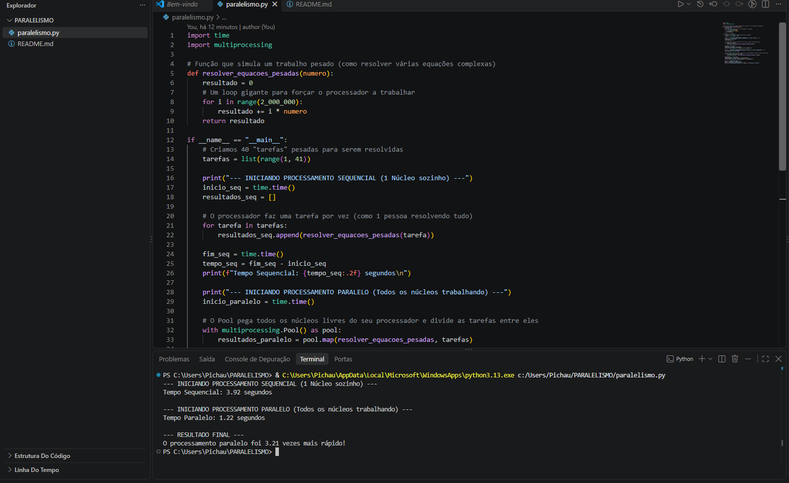

# Projeto Prático: Paralelismo com Memória Compartilhada 🚀

Este repositório contém a implementação prática do conceito de **Multiprocessamento e Memória Compartilhada**, desenvolvido para a disciplina de Fundamentos da Computação Concorrente, Paralela e Distribuída.

## 🎯 Motivação e Objetivo
A principal motivação para a construção deste script foi a dinâmica realizada em sala de aula pelo professor Yulle Gustavo, na qual os alunos foram divididos em grupos para simular o comportamento de *threads* resolvendo equações matemáticas de forma simultânea. 

O objetivo do projeto é comprovar, em código, o ganho de desempenho obtido ao abandonar a execução sequencial (um único núcleo sobrecarregado) e distribuir uma carga de trabalho pesada entre todos os núcleos físicos disponíveis no processador.

## 🛠️ Tecnologias Utilizadas
* **Linguagem:** Python 3.x
* **Biblioteca Principal:** `multiprocessing` (Nativa do Python)
* **Biblioteca Auxiliar:** `time` (Para medição de performance)

## ⚙️ Como testar na sua máquina

1. Clone este repositório para o seu computador abrindo o terminal e digitando:
   `git clone https://github.com/eduardoavv/Paralelismo_Threads.git`

2. Acesse a pasta do projeto recém-clonado:
   `cd Paralelismo_Threads`

3. Execute o script principal:
   `python paralelismo.py`

## 📊 Resultados Obtidos (Evidência)
O script realiza um loop de cálculo denso para simular as equações matemáticas. Durante os testes locais documentados, obtivemos os seguintes resultados práticos:

* **Tempo Sequencial (1 núcleo):** ~3.92 segundos
* **Tempo Paralelo (Todos os núcleos):** ~1.22 segundos

**Conclusão:** O processamento paralelo foi **3.21 vezes mais rápido** na resolução da mesma quantidade de tarefas, validando perfeitamente a eficácia da divisão de processamento.

---
## 👨‍💻 Autor
**Eduardo Artur** (GitHub: [@eduardoavv](https://github.com/eduardoavv))